# Simulation of Interference Techniques for Pulse Compressed Radar and PD Radars [with MATLAB Code]

MATLAB Simulation Results:  
1. Pulse Compression Radar Interference  
2. Triangle Wave Frequency Modulation Interference PD Radar  
3. Sine Wave Frequency Modulation Interference PD Radar  
4. Camber Type Noise Interference PD Radar  
5. Noise Phase Modulation Interference PD Radar  
6. Noise Frequency Modulation Interference PD Radar

## Images

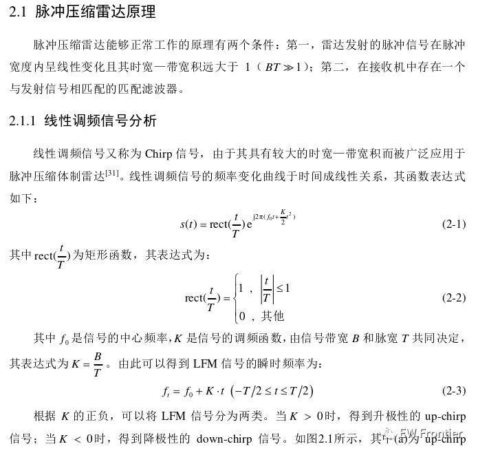
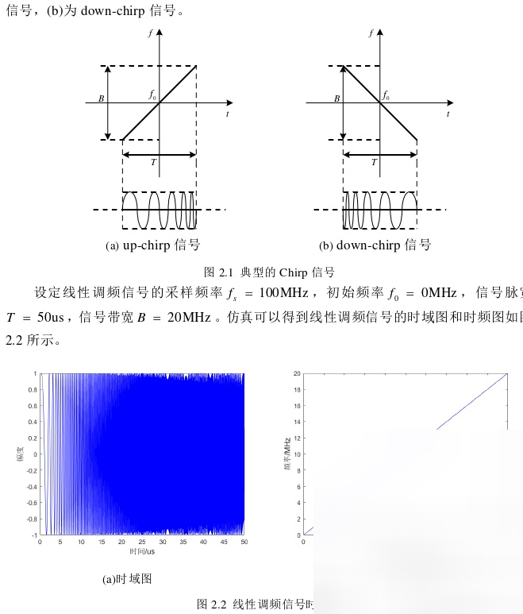
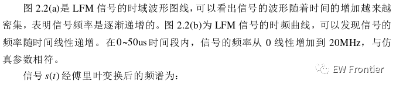
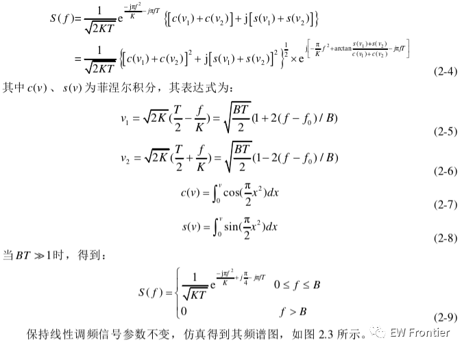
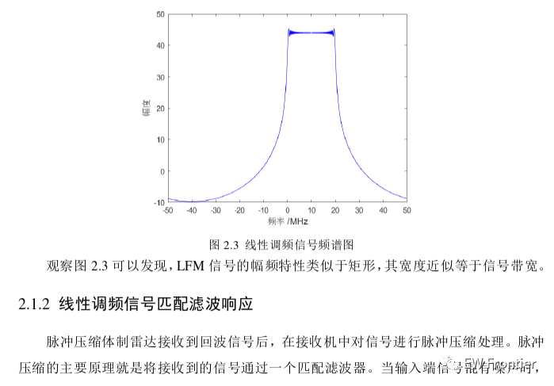
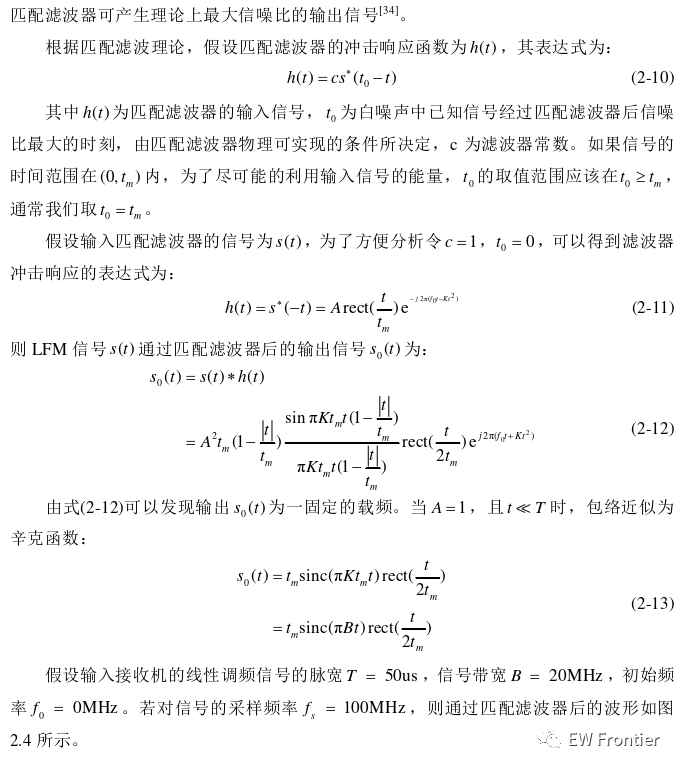
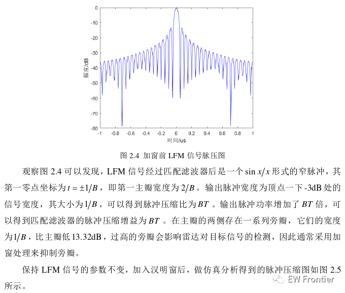
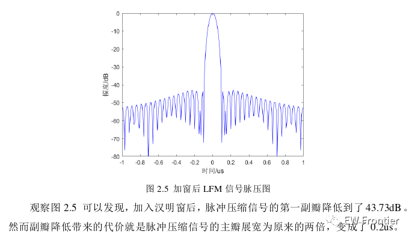
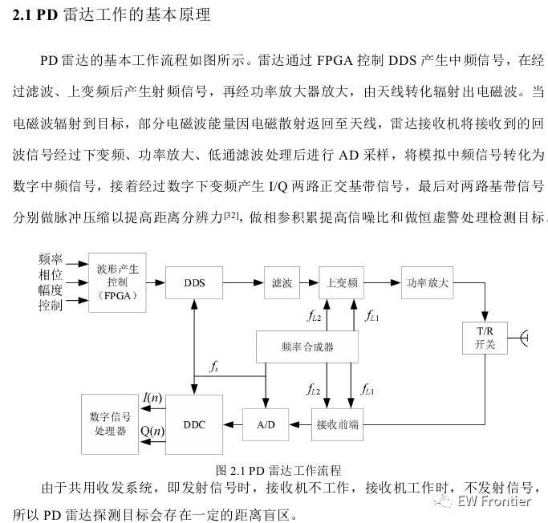
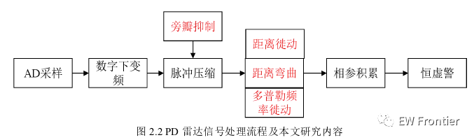
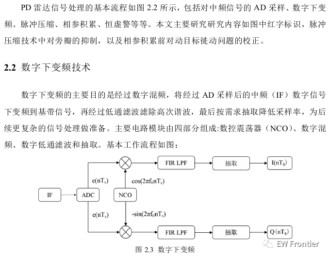
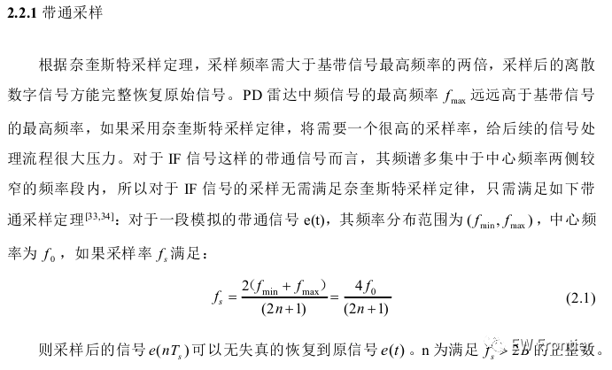
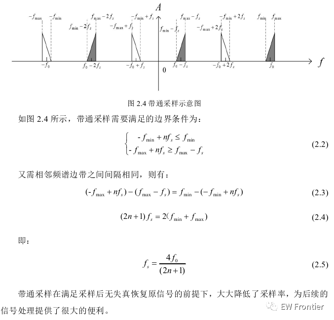
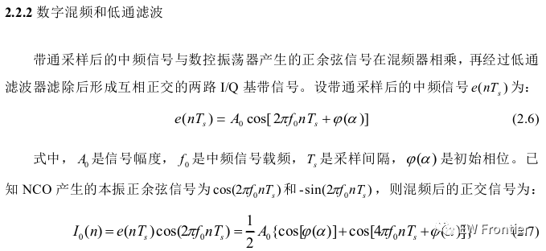
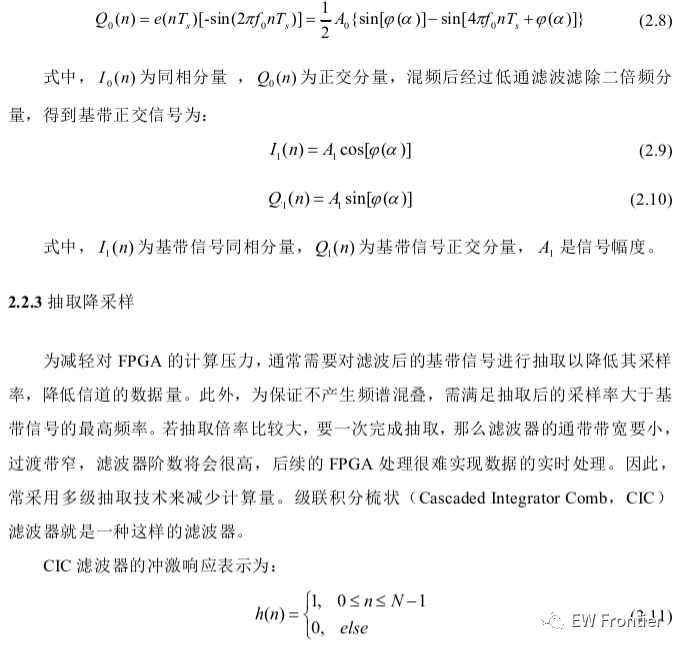
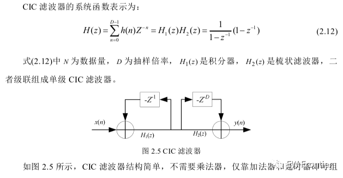
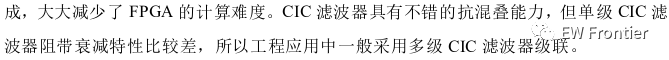
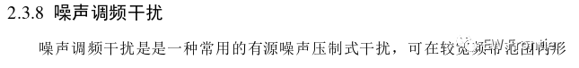
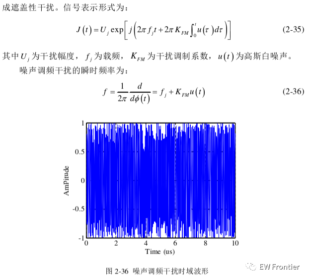
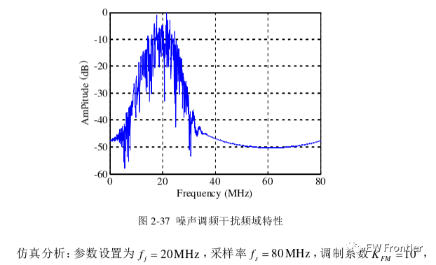
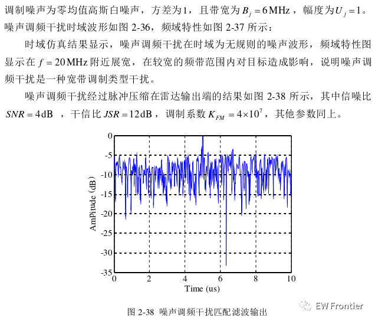
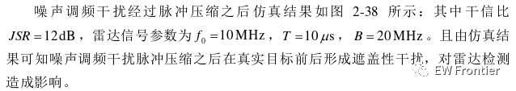
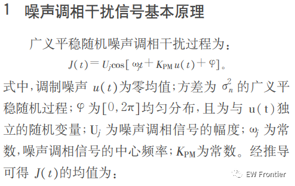
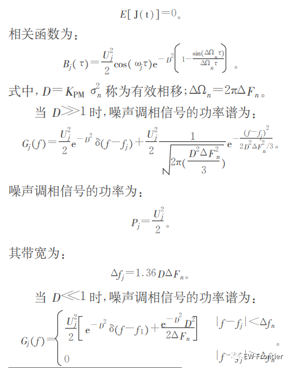
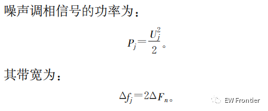
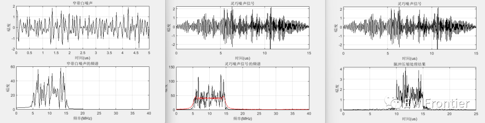
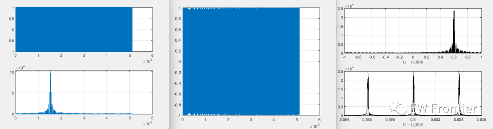
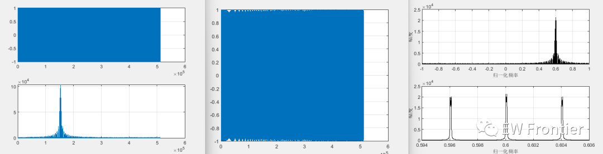
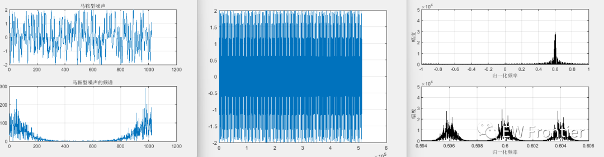
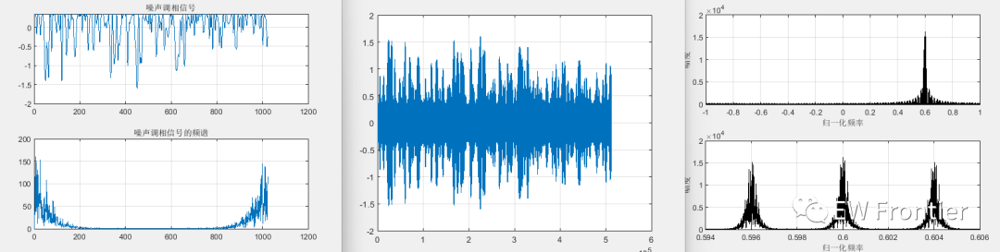
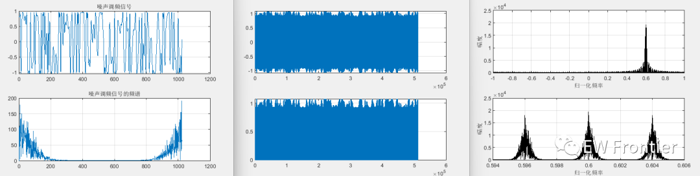

<!-- PAYMENT_BLOCK -->

## Get this dataset

- Payment link (Stripe): [Buy now](https://buy.stripe.com/3cs8yP7sY87d0vu9AB)
- Payment QR code: 

<!-- /PAYMENT_BLOCK -->
